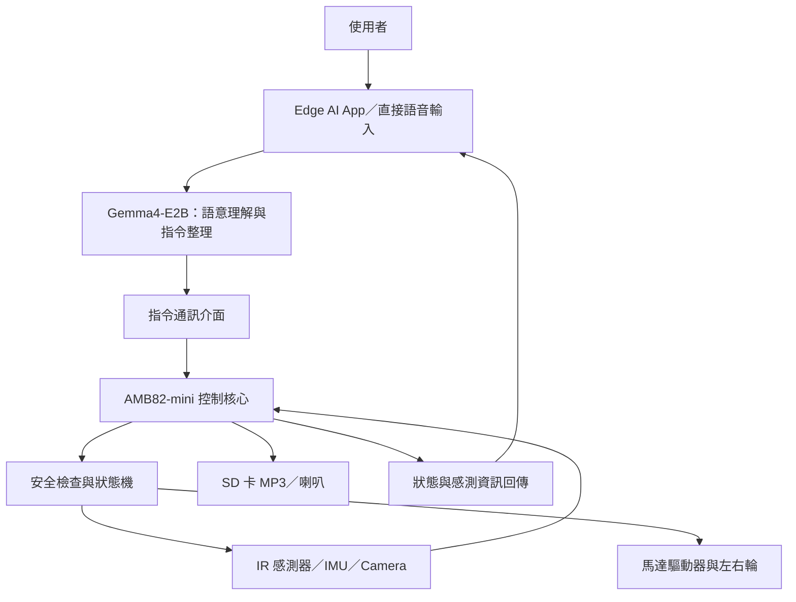

# AI Patrol Bot — 智慧語音互動自主巡邏機器人

> **使用晶片：AMB82-mini**  
> **AI 模型：Google Edge AI Gemma4-E2B（由相容的 Edge AI App／推論端提供）**  
 

## 1. 專題摘要

本專題規劃製作一台以 AMB82-mini 為硬體控制核心的兩輪智慧機器車，結合 Google Edge AI Gemma4-E2B，讓使用者能以自然語言下達移動與巡邏指令。機器車透過 IR 距離感測器偵測近距離障礙物，並使用攝影機擷取周遭影像、IMU 取得移動狀態；控制核心依據安全規則控制左右輪馬達，並透過喇叭播放預載 MP3 或外部 TTS 語音。

本專題將比較兩種互動方式：使用 Edge AI App 與 Gemma4-E2B 進行互動，以及使用者直接對機器車說話。第一階段以安全、可展示的語音指令與避障為主，進階功能再加入巡邏任務及影像描述。

## 2. 專題動機與目的

一般遙控車需要使用者持續操作方向控制；本專題希望將自然語言介面與嵌入式控制結合，讓使用者能以較直覺的方式指定任務，例如「往前走一段距離」、「開始巡邏」或「前面有障礙物嗎？」。藉由此專題學習 AI 模型與硬體控制的整合、感測器資料處理、通訊協定設計，以及實體系統測試。

## 3. 系統使用設備與技術

| 設備／技術 | 預計用途 |
|---|---|
| AMB82-mini | 讀取感測器、執行安全控制邏輯、控制馬達與音訊周邊 |
| Google Edge AI Gemma4-E2B | 自然語言理解、對話與指令整理；由相容的 Edge AI App／推論端執行 |
| Camera | 擷取環境影像，供使用者查看或交由支援的 AI 端分析 |
| IR 距離感測器 | 近距離障礙物偵測 |
| IMU | 取得姿態／移動狀態，輔助動作判斷 |
| Wheel Motor Driver | 控制左右輪馬達，完成前進、後退、轉向與停止 |
| Microphone／Audio input | 收錄直接語音互動（依實際硬體配置確認） |
| Speaker／SD card | 播放預載 MP3 或接收的 TTS 音檔 |

> **硬體與模型分工說明：** 本提案不假設 AMB82-mini 能直接執行完整 Gemma4-E2B 模型。模型推論由相容的 Edge AI App／推論端負責；AMB82-mini 負責感測、馬達控制、音訊播放及安全保護。實際通訊方式與支援的模型版本，須依課堂提供的 SDK、範例及硬體規格確認。

## 4. 預計實作功能

### 4.1 基本功能（必做）

1. **基本移動控制：** 支援前進、後退、左轉、右轉與停止。
2. **語音／App 指令：** 使用者透過 Edge AI App 或語音輸入自然語言，系統將指令轉成有限且明確的動作命令。
3. **紅外線避障：** 當 IR 感測器偵測到障礙物進入安全距離，立即停止馬達；必要時執行預先定義的退避動作。
4. **語音回應：** 以預載 MP3 或外部 TTS 音檔回覆執行狀態，例如「收到，開始前進」或「前方有障礙物」。
5. **緊急停止：** 無論目前執行何種任務，收到停止指令或觸發安全條件時，優先停止馬達。

### 4.2 進階功能（視時間選做）

1. **定時／定路線巡邏：** 依照簡單的時間或動作序列進行巡邏。
2. **影像擷取：** 依照使用者要求拍攝環境影像，並透過支援的 AI 端進行簡單描述。
3. **巡邏狀態回報：** 回報目前模式、最近一次避障事件及任務是否完成。

## 5. 系統架構

### 5.1 控制原則

- AI 只負責理解意圖並提出允許的高階命令，不直接輸出任意馬達訊號。
- AMB82-mini 端必須再次檢查命令格式、有效範圍與感測器安全條件。
- 避障與緊急停止的優先權高於一般移動命令。
- 通訊中斷、命令逾時或感測器異常時，採取停止馬達的安全策略。

## 6. 兩種互動方式比較

| 比較項目 | Edge AI App + Gemma4-E2B | 直接對機器車說話 |
|---|---|---|
| 輸入方式 | 手機 App 輸入文字／語音 | 機器車端收音 |
| 優點 | 介面清楚、較容易顯示辨識結果與狀態 | 操作直覺、不必一直拿手機 |
| 挑戰 | 需要手機與機器車之間的通訊 | 需要處理收音品質、噪音與語音辨識流程 |
| 適合情境 | 設定巡邏任務、查看狀態 | 簡單口令、停止與即時互動 |
| 安全設計 | App 命令仍須由控制核心驗證 | 語音命令仍須由控制核心驗證 |

## 7. 創新特色

1. **自然語言轉安全命令：** 將「幫我往前走一下」轉換為有限的動作命令，而不是讓 AI 直接控制馬達。
2. **雙模式互動比較：** 以相同任務測試 App 與直接語音的操作便利性、反應時間及成功率。
3. **安全優先的自主移動：** 由 AMB82-mini 本地端執行避障與緊急停止，降低 AI 判斷延遲或通訊異常造成的風險。
4. **可擴充任務模式：** 後續可增加巡邏路線、影像回報及更多語音情境。

## 8. 預計測試與評估方式

| 測試項目 | 評估方式 |
|---|---|
| 基本移動 | 各方向指令重複測試，記錄成功次數 |
| 語音／App 指令 | 測試前進、轉向、停止等指令辨識成功率 |
| 避障 | 以不同距離與位置的障礙物測試是否能及時停止 |
| 緊急停止 | 在移動中觸發停止，確認停止優先權 |
| 雙模式比較 | 比較完成相同任務所需時間、成功率與操作便利性 |

## 9. 預期成果

完成一台可接受自然語言指令、執行基本移動、進行近距離障礙物偵測、播放語音回應的兩輪機器車；若時程允許，再加入簡易自主巡邏與影像回報。最終以實體展示、系統架構圖、測試紀錄及 GitHub 文件呈現成果。

 

## 11. 風險與替代方案

- **模型或 App 無法直接連接 AMB82-mini：** 先以簡單通訊命令或預先定義的指令介面驗證硬體控制，再整合 AI。
- **直接語音收音效果不佳：** 先以手機 App 語音輸入作為主要展示方式，直接語音列為進階功能。
- **影像辨識整合時間不足：** 保留拍照與影像傳輸功能，不將即時物件辨識列為必要交付。
- **巡邏路線不穩定：** 先使用固定時間與動作序列，並保留人工停止功能。

## 12. 開發階段

1. 確認 AMB82-mini 開發環境與範例可正常執行。
2. 完成左右輪基本控制及 IR 避障。
3. 定義 App／AI 與控制板之間的命令格式。
4. 加入語音輸入、Gemma4-E2B 指令理解與語音回應。
5. 整合測試、記錄結果並製作展示內容。
