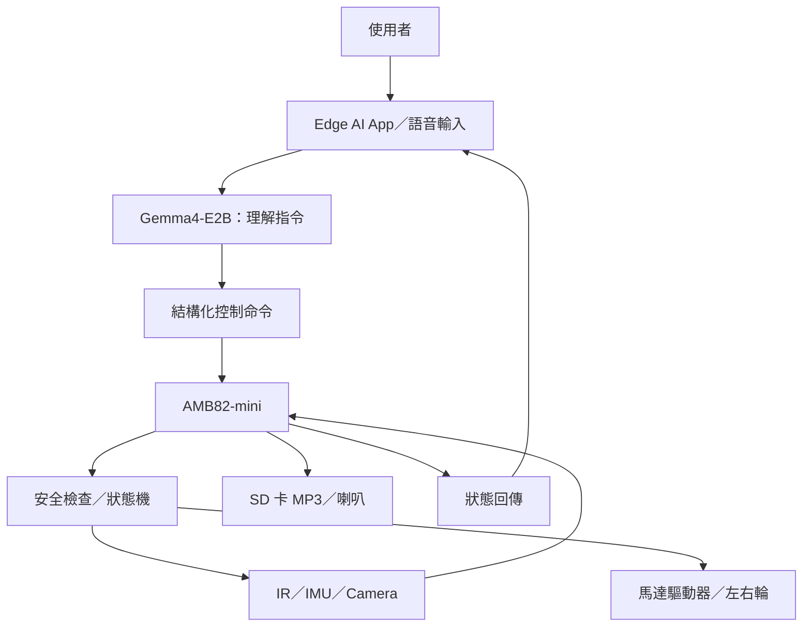
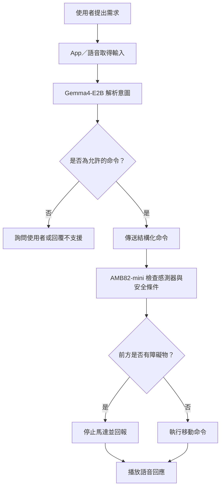

# 🤖 AI Patrol Bot — 智慧語音互動自主巡邏機器人

**AMB82-mini × Google Edge AI Gemma4-E2B**  
一台能理解自然語言、執行基本移動、偵測障礙物並以語音回應的智慧機器車。

## ✨ 專題特色

- 🗣️ **自然語言互動：** 透過 Edge AI App 或語音輸入下達任務。
- 🚗 **兩輪移動控制：** 前進、後退、轉向與停止。
- 🚧 **自動避障：** 透過 IR 距離感測器偵測近距離障礙物。
- 📷 **影像擷取：** 使用 Camera 拍攝周遭環境。
- 🔊 **語音回應：** 播放 SD 卡預載 MP3 或外部 TTS 音檔。
- 🧭 **自主巡邏（進階）：** 依照預設動作序列執行巡邏。

## 🧩 硬體與技術

| 項目 | 用途 |
|---|---|
| AMB82-mini | 感測資料讀取、控制邏輯與馬達控制 |
| Gemma4-E2B | 自然語言理解與 AI 對話，由相容的 Edge AI App／推論端執行 |
| Camera | 環境影像擷取 |
| IR Distance Sensor | 障礙物偵測 |
| IMU | 移動狀態感測 |
| Wheel Motor Driver | 左右輪馬達控制 |
| Speaker／SD Card | 語音與音效播放 |

> **架構備註：** 本專案不預設 AMB82-mini 能直接執行完整 Gemma4-E2B。AI 推論由相容的 Edge AI App／推論端負責，AMB82-mini 負責即時硬體控制。實際通訊協定、SDK 與支援功能須依課堂提供的開發資源驗證。

## 🏗️ 系統架構

## 🔄 指令執行流程

## 🧪 預計展示情境

1. 使用者說「向前走」，機器車執行短距離前進。
2. 機器車前方出現障礙物，IR 感測器觸發停止。
3. 機器車播放「前方有障礙物，已停止」的語音。
4. 使用者透過 App 要求開始簡易巡邏，機器車依照預設動作序列執行。
5. 使用者發出停止命令，機器車立即停止。

## 👥 團隊分工

| 成員 | 負責項目 |
|---|---|
| 組員 A（待填） | AMB82-mini、馬達、感測器與安全控制 |
| 組員 B（待填） | Gemma4-E2B、語音互動與命令解析 |
| 組員 C（待填） | App／通訊、整合測試與文件（若為三人組） |

## 🗂️ 專案檔案

- [`PROPOSAL.md`](PROPOSAL.md)：完整專題提案、功能規劃、架構、測試與風險評估。
- [`assets/ai-patrol-bot-concept.png`](assets/ai-patrol-bot-concept.png)：AI 生成專題概念圖。

## 🚀 開發狀態

目前為**專題提案與系統規劃階段**，尚未代表硬體功能已完成。後續將依序完成開發環境確認、基本馬達控制、IR 避障、AI 指令整合及實體測試。

- [ ] AMB82-mini 開發環境確認
- [ ] 左右輪基本移動
- [ ] IR 障礙物偵測與緊急停止
- [ ] App／AI 命令通訊
- [ ] 語音輸入與語音回應
- [ ] 簡易巡邏模式
- [ ] 實體整合測試與展示

## 📚 參考範例

- 老師提供的 AI Plush Giraffe 範例：<https://github.com/rkuo2000/AI-plush-giraffe>

## 📝 提交前請補齊

1. 組員姓名、學號與工作分配。
2. 實際使用的 AMB82-mini 周邊、接線與通訊方式。
3. 開發環境、函式庫與測試結果。
4. 若參與瑞昱科技計畫評審，請在此註明意願。
